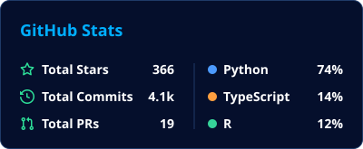
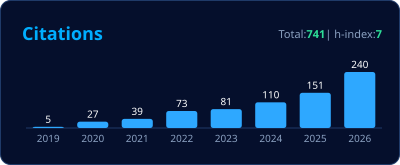

Senior Applied Scientist at [AWS Forward Deployed Engineering](https://aws.amazon.com/professional-services/forward-deployed-engineering/), with a PhD in machine learning and nine years in applied AI. I embed with enterprise customer teams and ship production LLM and agentic systems end to end, from fine-tuned models to multi-agent pipelines and MCP-based coding assistants. I publish what we learn as peer-reviewed papers, talks and open-source tools.

